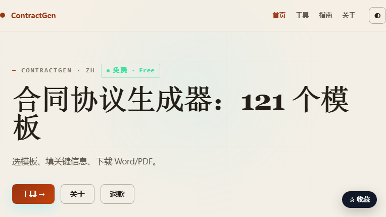

# ContractGen

> **1365 份合同、协议、函件与表单模板。**
>
> 选模板 · 填关键字段 · 预览 · 下载 Word / PDF  
> 浏览器本地生成 · 不上传表单

官网：**https://contractgen.mengstone.com/**  
中文名：**ContractGen 合同模板**



---

## 这是什么

ContractGen 把常见合同整理成可搜索的模板卡片：

```text
找模板 → 填甲方/乙方/金额/日期等关键字段
→ 预览 → 下载 Word（.docx）或 PDF
```

**1365 份模板**覆盖：

- 房屋租赁
- 借款 / 欠条
- 劳动合同
- 服务 / 合作
- 买卖 / 采购
- 装修 / 工程
- 股权 / 合伙
- 家政 / 婚姻 / 继承
- 委托 / 授权
- 函件 / 通知 / 表单

---

## 为什么不是“网盘里 10GB 合同包”

网盘合同包的常见问题：

- 不知道哪份能用
- 下载后全是空白模板
- 关键条款没有提示
- 文件名混乱，搜不到
- 版本旧，不知道是否更新

ContractGen 的做法：

| 问题 | 设计 |
|---|---|
| 不知道选哪份 | 按分类/搜索，卡片式选择 |
| 不知道怎么填 | 关键字段表单，留空显示下划线 |
| 怕填错 | “填入示例”快速预览 |
| 格式不统一 | 统一生成 Word / PDF |
| 担心上传 | 表单、预览、文件生成全部在浏览器本地 |
| 不知道风险 | 页面标明使用场景、关键条款与风险提示 |

---

## 使用流程

1. 按分类或搜索找到模板
2. 点卡片进入填写页
3. 填甲方/乙方、金额、日期、期限等关键字段
4. 点“填入示例”快速看效果
5. 下载 Word（.docx）或 PDF

Word 是 `.docx`；PDF 在浏览器本地生成。

---

## 适合谁

- 需要快速起草租房、借款、劳动、服务、买卖合同的个人
- 需要给客户发合同初稿的小团队/个体户
- 需要统一合同格式的行政/运营
- 想先看模板结构，再找律师审核的人

## 不适合谁

- 想直接拿模板当“法律意见”签字的人
- 需要律师定制条款、尽调、诉讼的人
- 需要官方登记/备案系统的人

---

## 重要边界

ContractGen 是**起草辅助工具**，不是律师事务所，也不提供法律意见。

- 模板只是起点
- 是否有效取决于内容、签署方式、主体资格和当地法律
- 正式签署前，请根据当地法律审核；复杂交易请找律师
- 金额、日期、主体信息不要留空
- 不要直接套用与当地强制性规定冲突的条款

---

## 数据与隐私

- 表单填写在浏览器本地完成
- 预览在本地生成
- Word/PDF 在本地生成
- 不上传表单内容
- 不需要登录即可使用基础功能

> 具体账号、会员、下载限制以官网为准。

---

## English overview

**ContractGen** is a Chinese-first contract template library and generator.

- **1,365** contract, agreement, letter and form templates
- Categories include rental, loans, employment, services, sales, renovation, equity, family and authorization
- Pick a template, fill key fields, preview, then download **Word (.docx)** or **PDF**
- Forms, preview and file generation run **locally in the browser**
- Templates are drafting aids, **not legal advice**; review against local law before signing

Official site: **https://contractgen.mengstone.com/**

---

## 说明

- 这是产品介绍仓库，不是开源代码仓库。
- 模板数量、分类、下载方式以官网为准。
- 模板不构成法律意见；正式签署前请审核。
- 由萌石科技团队维护。

**官网：https://contractgen.mengstone.com/**
